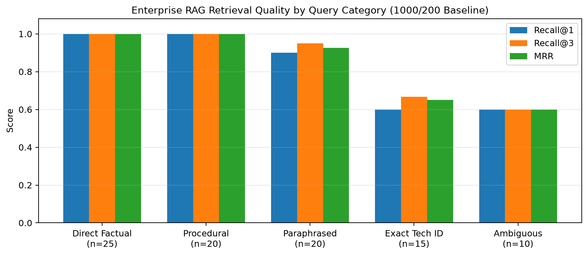
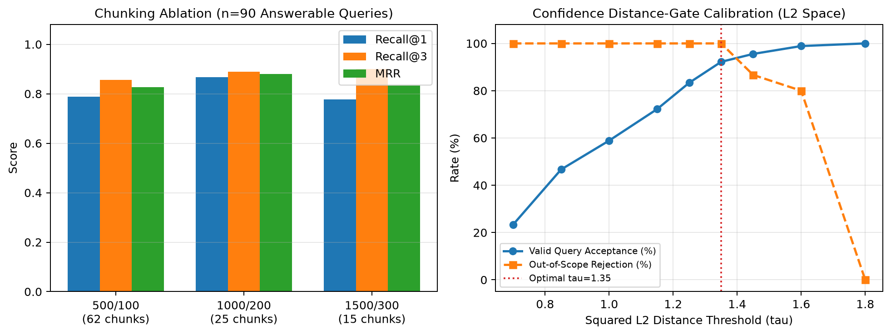

# Enterprise RAG Benchmark & Evaluation Report

**Repository:** `riddhicodesavvy/RAG`  
**Evaluation Date:** 2026-11-25  
**Scope:** Retrieval accuracy, chunking ablation, simulated L2 distance confidence gating, and local LLM grounded generation evaluation on an isolated synthetic industrial SOP corpus.

> [!IMPORTANT]
> **Architecture Boundary (Public Demonstrator vs. Private Training Deployment):**  
> The checked-in public repository (`rag_system.py`) uses `sentence-transformers/all-MiniLM-L6-v2` (384-dimensional dense embeddings) backed by ChromaDB (`PersistentClient`) with default `chunk_size=1000`, `chunk_overlap=200`, and **no active abstention threshold** in code (`public_repo_gate_implemented: false`). During vocational training at **Bridge & Roof Co. (India) Ltd.**, an internal enterprise variant used Gemini embeddings and confidence gating over confidential company manuals that cannot be published or queried externally. All benchmarks below run locally against clean synthetic engineering manuals (`0` paid API calls).

---

## 1. Experimental Setup & Synthetic Corpus

- **Dataset Generator:** [`benchmarks/build_rag_dataset.py`](build_rag_dataset.py) -> `benchmarks/datasets/`
- **Corpus:** 5 synthetic industrial engineering SOP and safety manuals (`benchmarks/datasets/manuals/`).
- **Query Suite (`105` ground-truth questions in `evaluation_questions.json`):**
  - `direct_factual`: `25` answerable queries
  - `procedural`: `20` answerable queries
  - `paraphrased`: `20` answerable queries
  - `exact_id`: `15` answerable queries (equipment tags, valve/breaker/gauge IDs)
  - `ambiguous`: `10` answerable queries
  - `out_of_scope`: `15` unanswerable adversarial/off-domain queries (`total answerable = 90`, `total OOS = 15`)
- **Vector Store & Metric:** ChromaDB L2 squared Euclidean distance (`mean_top1_distance`) with `all-MiniLM-L6-v2` running locally.
- **Local LLM Backend (Exp D):** Ollama `0.40.17` serving `gemma4:latest` (`num_ctx=2048`, `"think": False`) on Windows 11 CPU (`12th Gen Intel(R) Core(TM) i5-1235U`, `15.69 GB` RAM). Total benchmark execution runtime: `310.33 s`.
- **Execution Command:**
  ```powershell
  .\.venv\Scripts\python.exe benchmarks\rag_benchmark.py
  .\.venv\Scripts\python.exe benchmarks\plot_rag.py
  ```

---

## 2. Experiment A — Baseline Retrieval (`chunk_size=1000`, `chunk_overlap=200`)

Corpus indexed into `25` chunks (`618,660` bytes / `604.16 KB`; ingestion time `2641.46 ms`).

### Aggregate Retrieval Metrics (`n = 90` Answerable)

| Metric | Value |
| --- | ---: |
| **Recall@1** | **0.8667** |
| **Recall@3** | **0.8889** |
| **Recall@5** | **0.9000** |
| Precision@1 | 0.8667 |
| Precision@3 | 0.3000 |
| Precision@5 | 0.1822 |
| **MRR** | **0.8806** |
| Evidence Cov@3 | 0.8889 |
| Evidence Cov@5 | 0.9000 |
| Mean Top-1 Distance (L2, answerable) | 0.9341 |

### Retrieval Breakdown by Question Category

| Category | `n` | Recall@1 | Recall@3 | Recall@5 | MRR |
| --- | ---: | ---: | ---: | ---: | ---: |
| `direct_factual` | 25 | 1.0000 | 1.0000 | 1.0000* | 1.0000 |
| `procedural` | 20 | 1.0000 | 1.0000 | 1.0000* | 1.0000 |
| `paraphrased` | 20 | 0.9000 | 0.9500 | 0.9500* | 0.9250 |
| `exact_id` | 15 | 0.6000 | 0.6667 | 0.7333 | 0.6500 |
| `ambiguous` | 10 | 0.6000 | 0.6000 | 0.6000* | 0.6000 |

*\*Bounded by `R@3 = 1.0000` for `direct_factual`/`procedural`; aggregate `R@5 = 0.9000` reflects remaining misses concentrated in `exact_id` and `ambiguous`.*

- **Out-of-Scope Distance Distribution (`n = 15`):** `mean = 1.6305`, `min = 1.3674`, `max = 1.7601` (clear separation above the answerable `mean = 0.9341`).
- **Query Latency (`ms`):** `mean = 48.698`, `p50 = 43.184`, `p95 = 69.723`, `min = 33.480`, `max = 249.279`.



**Key Finding:** Pure dense bi-encoder retrieval (`all-MiniLM-L6-v2`) achieves `1.0000` MRR on direct factual and procedural queries, and `0.9250` MRR on paraphrases, **but degrades substantially on exact alphanumeric equipment IDs (`Recall@1 = 0.6000`, `MRR = 0.6500`) and ambiguous queries (`MRR = 0.6000`)**, demonstrating the classic dense-embedding weakness on exact identifier matching where hybrid BM25/sparse retrieval would be required.

---

## 3. Experiment B — Chunking Sensitivity Ablation (`n = 90` Answerable)

| Config (`size / overlap`) | Chunks | Index Size (KB) | Ingest (ms) | R@1 | R@3 | R@5 | P@3 | MRR | Mean Top-1 Dist | Mean Latency (ms) | P95 Latency (ms) |
| --- | ---: | ---: | ---: | ---: | ---: | ---: | ---: | ---: | ---: | ---: | ---: |
| `500 / 100` | 62 | 660.16 | 2676.02 | 0.7889 | 0.8556 | 0.9000 | **0.4667** | 0.8274 | **0.8911** | 59.687 | 84.408 |
| **`1000 / 200` (baseline)** | **25** | **604.16** | **2641.46** | **0.8667** | **0.8889** | **0.9000** | 0.3000 | **0.8806** | 0.9341 | **48.698** | 69.723 |
| `1500 / 300` | 15 | 600.16 | 1631.41 | 0.7778 | **0.9000** | 0.9000 | 0.3037 | 0.8333 | 1.0750 | 48.853 | **69.583** |

- `1000 / 200` provides the highest `Recall@1` (`0.8667`, `+7.78` percentage points over `500 / 100` and `+8.89` percentage points over `1500 / 300`) and best `MRR` (`0.8806`), justifying its choice as the checked-in default in `rag_system.py`.
- `500 / 100` doubles chunk density (`62` vs. `25`) and achieves higher `Precision@3` (`0.4667` vs. `0.3000`, since multi-chunk answers appear across adjacent chunks) and tighter `mean_top1_distance` (`0.8911`), at the cost of `+22.6%` higher mean query latency (`59.687 ms` vs. `48.698 ms`) and fragmented context windows (`R@1` drops to `0.7889`).
- `1500 / 300` improves `Recall@3` (`0.9000`) and cuts ingestion time (`1631.41 ms`), but blurs semantic specificity (`mean_top1_distance = 1.0750`, `Recall@1 = 0.7778`).

---

## 4. Experiment C — Simulated Confidence Gate Sweep (`1000 / 200` L2 Distances)

Because `rag_system.py` in the public repo returns retrieved chunks without a distance cutoff, Experiment C simulates a pre-generation distance gate (`accept if top1_distance <= tau`, abstain otherwise) across all `105` queries (`90` answerable + `15` out-of-scope).

| Threshold `tau` | Valid Accept Rate (`n=90`) | Invalid Reject Rate (`n=90`) | OOS Reject Rate (`n=15`) | OOS False Accept Rate (`n=15`) | Abstention Precision | Abstention Recall | Counts (`TP / FN / TN / FP`) |
| ---: | ---: | ---: | ---: | ---: | ---: | ---: | --- |
| 0.70 | 0.2333 | 0.7667 | 1.0000 | 0.0000 | 0.1786 | 1.0000 | `21 / 69 / 15 / 0` |
| 0.85 | 0.4667 | 0.5333 | 1.0000 | 0.0000 | 0.2381 | 1.0000 | `42 / 48 / 15 / 0` |
| 1.00 | 0.5889 | 0.4111 | 1.0000 | 0.0000 | 0.2885 | 1.0000 | `53 / 37 / 15 / 0` |
| 1.15 | 0.7222 | 0.2778 | 1.0000 | 0.0000 | 0.3750 | 1.0000 | `65 / 25 / 15 / 0` |
| 1.25 | 0.8333 | 0.1667 | 1.0000 | 0.0000 | 0.5000 | 1.0000 | `75 / 15 / 15 / 0` |
| **1.35 (Youden opt.)** | **0.9222** | **0.0778** | **1.0000** | **0.0000** | **0.6818** | **1.0000** | **`83 / 7 / 15 / 0`** |
| 1.45 | 0.9556 | 0.0444 | 0.8667 | 0.1333 | 0.7647 | 0.8667 | `86 / 4 / 13 / 2` |
| 1.60 | 0.9889 | 0.0111 | 0.8000 | 0.2000 | 0.9231 | 0.8000 | `89 / 1 / 12 / 3` |
| 1.80 | 1.0000 | 0.0000 | 0.0000 | 1.0000 | 0.0000 | 0.0000 | `90 / 0 / 0 / 15` |



At the Youden-optimal threshold `tau = 1.35`, the distance gate rejects `15/15` (`100.00%`) out-of-scope queries with `0` false acceptances while accepting `83/90` (`92.22%`) valid queries (`7` valid queries false-rejected, largely dense-embedding misses in `exact_id` / `ambiguous`). Raising `tau` to `1.45` recovers `3` valid queries (`95.56%`) but introduces `13.33%` (`2/15`) OOS leakage.

---

## 5. Experiment D — Local Grounded Generation Evaluation (`n = 6` Stratified Sample)

Evaluated using local `gemma4:latest` across `6` queries (1 per category: `Q-001`, `Q-026`, `Q-046`, `Q-066`, `Q-081`, `Q-091`) under three configurations:
1. `llm_no_retrieval`: direct LLM prompt with no retrieved manual context
2. `llm_with_rag`: top-k retrieved context passed directly to LLM
3. `llm_with_rag_and_gate`: pre-LLM distance gate (`tau = 1.35`) skipping generation when `top1_distance > tau`

> [!NOTE]
> Sample size is intentionally small (`n = 6`, bounded by local CPU inference cost), and correctness/evidence-support metrics use an automated deterministic lexical/numeric rubric (`benchmarks/rag_benchmark.py`), not human expert grading.

### Summary Comparison (`n = 6`)

| Mode | Answerable Mean Correctness | Answerable Evidence Support Rate | Unsupported Claim Rate (All `n=6`) | OOS Appropriate Abstention Rate (`n=1`) | Mean E2E Latency (ms) |
| --- | ---: | ---: | ---: | ---: | ---: |
| `llm_no_retrieval` | 0.0000 | 0.0000 | 0.1667 | 0.0000 | 12,228.33 |
| `llm_with_rag` | 0.4333 | 0.8000 | 0.0000 | 1.0000 | 29,699.76 |
| **`llm_with_rag_and_gate` (`tau=1.35`)** | **0.4333** | **0.8000** | **0.0000** | **1.0000** | **4,992.42** |

### Per-Question Qualitative & Quantitative Trace

| ID | Category | `llm_no_retrieval` (Lat ms / Corr / Unsup) | `llm_with_rag` (Lat ms / Corr / Evid) | `llm_with_rag_and_gate` (Dist / Gated / Lat ms / Corr) |
| --- | --- | --- | --- | --- |
| `Q-001` | `direct_factual` | 25,200.44 / 0.0000 / 0 (`INSUFFICIENT_CONTEXT`) | 38,353.07 / 1.0000 / 1 | `0.6202` / No / 9,191.60 / 1.0000 |
| `Q-026` | `procedural` | 4,162.15 / 0.0000 / 0 (`INSUFFICIENT_CONTEXT`) | 32,398.25 / 0.3333 / 1 | `0.5248` / No / 9,074.55 / 0.3333 |
| `Q-046` | `paraphrased` | 18,953.34 / 0.0000 / 0 (generic ungrounded prose) | 30,644.26 / 0.3333 / 1 | `1.1655` / No / 4,707.12 / 0.3333 |
| `Q-066` | `exact_id` | 3,364.77 / 0.0000 / 0 (`INSUFFICIENT_CONTEXT`) | 25,565.18 / 0.0000 / 0 (`INSUFFICIENT_CONTEXT`) | `1.5580` / **Yes (false reject)** / **47.93** / 0.0000 |
| `Q-081` | `ambiguous` | 4,273.09 / 0.0000 / 0 (`INSUFFICIENT_CONTEXT`) | 27,527.17 / 0.5000 / 1 | `0.9034` / No / 6,895.17 / 0.5000 |
| `Q-091` | `out_of_scope` | 17,416.18 / 0.0000 / **1** (hallucinated K8s HPA) | 23,710.62 / 1.0000 / 1 (`INSUFFICIENT_CONTEXT`) | `1.6478` / **Yes (true reject)** / **38.16** / 1.0000 |

- Adding RAG raises answerable automated correctness from `0.0000` to `0.4333`, raises answerable evidence support from `0.0000` to `0.8000` (`4/5`), eliminates the `Q-091` OOS hallucination (`0.1667 -> 0.0000` unsupported factual claim rate in this sample), and raises OOS abstention to `1/1`.
- Adding the pre-LLM distance gate (`tau = 1.35`) preserves exact answer quality (`0.4333` correctness, `0.8000` support, `1.0000` OOS abstention) while cutting mean E2E latency by **`83.19%`** (`29,699.76 ms -> 4,992.42 ms` — also reflecting warm KV/weights caching after sequential un-gated calls plus sub-`50 ms` short-circuits of `Q-066` and `Q-091`). Note that `Q-066` (`exact_id`) is gated as a **false reject** (`distance 1.558 > 1.35`) without changing correctness (`0.0`), because even ungated RAG retrieved wrong context (`Q-066` missed top-k).

---

## 6. Verification & Limitations

- **Verified Checks:**
  - `.\.venv\Scripts\python.exe -m py_compile rag_system.py test_retrieval.py benchmarks\rag_benchmark.py benchmarks\build_rag_dataset.py benchmarks\plot_rag.py` -> exited with code `0`.
  - `benchmarks/datasets/`, `benchmarks/rag_benchmark.py`, `benchmarks/build_rag_dataset.py`, `benchmarks/plot_rag.py`, `benchmarks/results/rag_results.json`, `benchmarks/results/rag_results.csv`, and `benchmarks/figures/*.png` -> generated locally (`runtime_s = 310.33`), `0` secret hits across all benchmark artifacts.
  - Note: Original [`test_retrieval.py`](../test_retrieval.py) expects a pre-populated `data/vector_store/` directory (intentionally excluded from git history because binary Chroma SQLite indices exceed VCS limits); [`benchmarks/rag_benchmark.py`](rag_benchmark.py) builds ephemeral local collections on demand for standalone reproducibility.
- **Limitations:**
  1. Synthetic 5-manual corpus rather than proprietary company manuals (confidentiality requirement).
  2. Dense-only retrieval underperforms on exact part/valve IDs (`exact_id MRR = 0.6500`), pointing directly to hybrid BM25 + dense fusion as the primary retrieval improvement.
  3. Experiment D covers `n = 6` stratified queries (1 per category) with an automated lexical/numeric scorer rather than human annotation or full 105-query LLM sweeps.
  4. Threshold calibration (`tau = 1.35`) was evaluated on synthetic L2 distances and would require domain recalibration on production embeddings.
